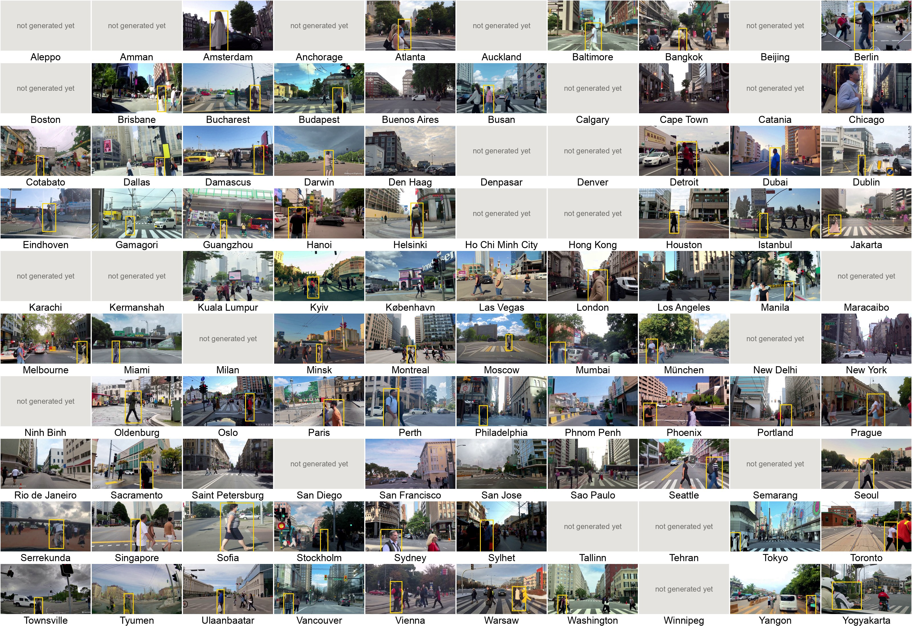
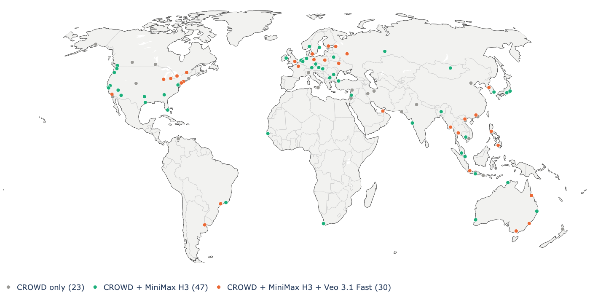
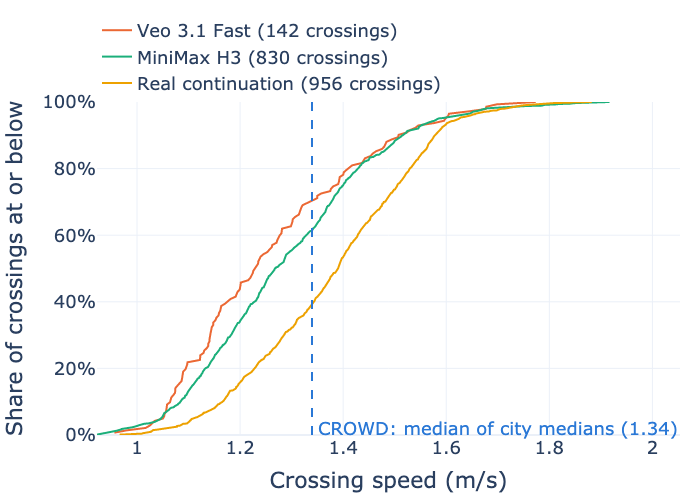
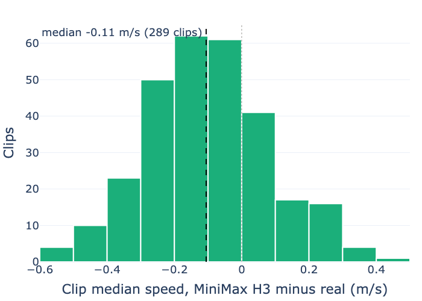
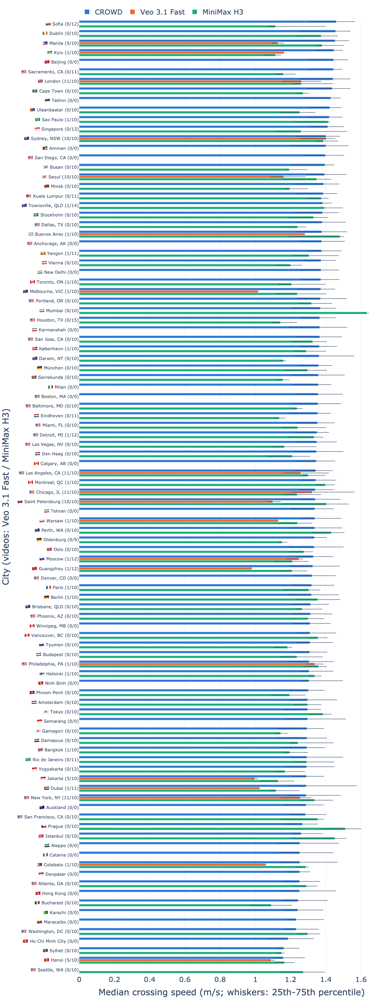
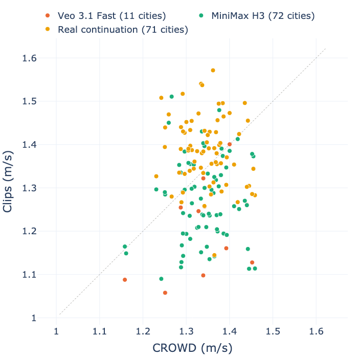
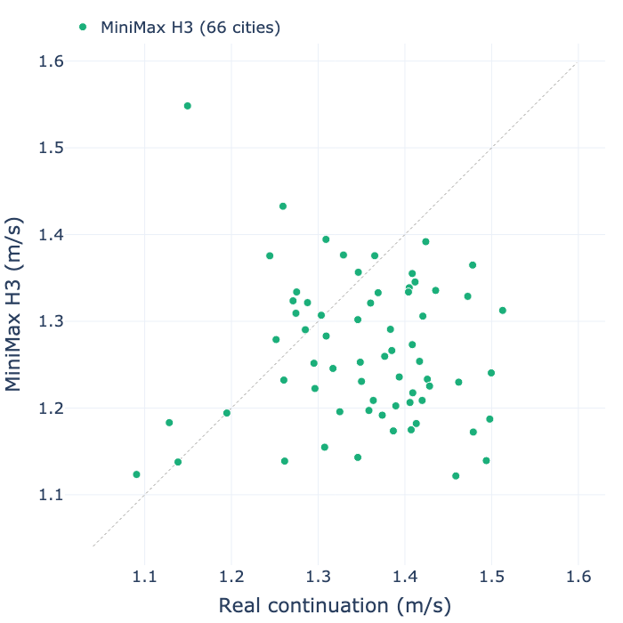
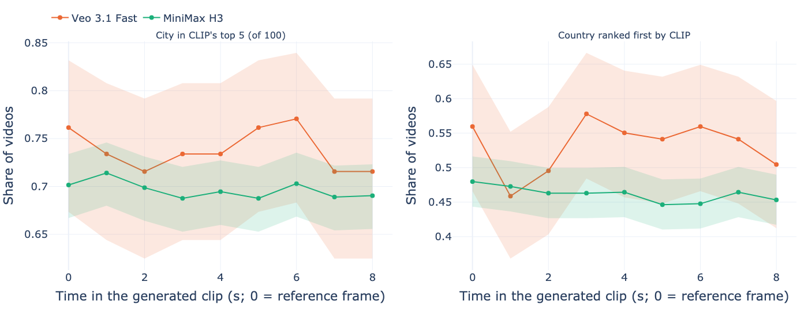
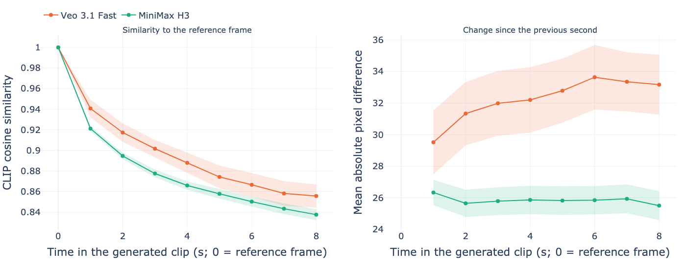

# Pedestrian crossing speed and hesitation time from dashcam videos

Detects and tracks road users in dashcam videos with YOLOv11x and BoT-SORT, then
measures, for every pedestrian who crosses the road in front of the car:

- **crossing speed**: crowd-city's relative motion index (see below)
- **hesitation time** (s): how long the pedestrian stood still before stepping onto the road
- **crossing time** (s): how long the crossing was observed

Tracking follows [crowd-dataset/crowd](https://github.com/crowd-dataset/crowd). The analysis is
the crowd-city code itself ([crowd-dataset/crowd-city](https://github.com/crowd-dataset/crowd-city)):
`crowd_city/` holds an unchanged copy of its crossing detection, metrics and road-surface
segmentation modules (commit in `crowd_city/SOURCE_COMMIT`), and `analysis.py` calls them in the
same order as crowd-city's own `analysis.py`.

## Data layout

```
data/
├── Amsterdam/
│   ├── drive_01.mp4
│   └── drive_02.mp4
└── Delhi/
    └── morning.mov
```

Every sub-folder of `data/` is a city, and every video in it (sub-folders included) is analysed.

## Setup

```bash
uv sync
cp default.config config
```

`config` must contain every key of `default.config` (the run stops otherwise). `default.secret` → `secret` is only needed for email notifications. Segmentation needs `ffmpeg`/`ffprobe` on the PATH; the SegFormer model is downloaded from Hugging Face on first use.

## Running

1. **Tracking** writes one CSV per video to `_output/bbox/<city>/<video>_<fps>.csv`, a `<video>_<fps>.json` next to it with the tracking settings used, and `_output/videos.csv` (city, fps, size and duration of every video). As in crowd, YOLO runs at confidence 0.0 so the tracker sees every box; `min_confidence` is applied when the analysis reads the CSV. Videos that already have a CSV are skipped unless `always_analyse` is true, and an interrupted video is redone on the next run. If the tracking settings differ from those stored with a CSV, the run warns but keeps the CSV: delete it (or set `always_analyse`) to track it again.

   ```bash
   uv run python main.py
   ```

   The first run downloads `yolo11x.pt` through ultralytics. The device is picked automatically (CUDA, Apple MPS, then CPU).

2. **Analysis** writes `_output/crossings.parquet` and `_output/crossings.csv` (one row per crossing), `_output/city_summary.csv` (one row per city) and plotly figures in `_output/figures/`.

   ```bash
   uv run python analysis.py
   ```

   Add `--force` to ignore the cache and analyse every video again.

### What is rerun

| Change | Rerun |
|---|---|
| New video in `data/` | Tracking and analysis of that video only |
| Nothing | Nothing (cached results are combined again) |
| A tracking CSV or video is rewritten | Analysis of that video |
| Code in `crowd_city/` or `analysis.py`, or a setting that changes results (`min_confidence`, road strip, `check_per_sec_time`, `crossing_rule`, segmentation model and sampling) | Analysis of every video; SegFormer labels are reused from the store when the crossing tracks and segmentation settings are unchanged |
| Comments, docstrings or formatting in that code | Nothing |
| Speed or waiting-time limits, `segmentation_is_primary`, plots, summary | Nothing (always rebuilt from the cached values) |

Per-video results are cached in `_output/analysis/<city>/<video>_<fps>.json` with a key built from their inputs (see `utils/cache.py`), and crowd-city's surface-label store is kept in `_output/segmentation/`.

### Generated videos and the comparison with CROWD

The generated videos are kept in the project's Google Drive folders (Veo 3 by Tanvir, MiniMax H3 by Zi). `fetch_generated_videos.py` mirrors them to `data/_drive/`, links each video into `data/<model>/<city>/` (so `"data": "data/veo3"` in `config` tracks one model) and lists every video in `data/generated_videos.csv` with its model, city, batch, source YouTube frame, resolution, fps and duration. Rerun it to pick up new videos; the videos are never committed.

```bash
uvx --with gdown python fetch_generated_videos.py
```

Drive refuses anonymous downloads after a few hundred files. Then download the folder in a signed-in browser and pass the zip(s) with `--zip <folder>=<path pattern>` (see the script's docstring).

`speed_generated_vs_crowd.py` draws the median crossing speed per city with one bar each for CROWD (crowd-city's `crowd_crossing_speed_by_city.csv`, `--crowd`), Veo 3 and MiniMax H3 (the same table per model with a `model` column, `--generated`; cities without a value get no bar), and `--pdf` writes a copy for the paper.

To measure crossing speed in m/s as crowd-city does for CROWD, set `speed_model` to crowd-city's frozen Waymo calibration (`waymo_processed/calibration_v32/crowd_waymo_pipeline_model.json`, with its `speed_validation/` folder next to it) and track each set into its own output folder (`"data": "data/veo3", "output": "_output/veo3"`, and so on). `paired_real_clips.py --videos '<CROWD video folders>'` cuts the real 8 seconds that follow each MiniMax H3 reference frame from the CROWD video it came from into `data/real_minimax/<city>/`, under the generated clip's file name, so that set can be tracked the same way. `generated_speeds.py` then reads the three `_output/<set>/` folders and writes the per-city speeds (`_output/generated_speed_by_city.csv`, the `--generated` input above), the share of clips with a counted crossing, the rank correlations of the city medians with CROWD and with the real continuations, a per-clip table of the MiniMax/real pairs, and two scatter plots. `speed_statistics.py` runs the paper's tests on the same folders (bootstrap intervals, McNemar, Wilcoxon, Kruskal-Wallis, split-half reliability of the city medians; `--scaled` adds the real continuations scaled to 864×480 as a check that the speed difference is not a matter of resolution), and `city_frames.py` draws one frame per city.

`appearance_analysis.py --mapping <crowd>/mapping.csv` measures with CLIP how well each generated video keeps the look of its city (see [Generated videos and CROWD](#generated-videos-and-crowd)) and draws the map of the cities. It needs `open_clip_torch` besides this project's packages; embeddings are cached in `_output/appearance/`, so a rerun only embeds new videos. Both scripts take `--readme` to refresh their figures in `readme/`.

## Method

All of this is crowd-city's code; see its README for the details.

1. **Detections** below `min_confidence` (0.7) and boxes without a track id are dropped.
2. **Crossing candidates.** With `crossing_rule: "road_crossing"` (rule D, crowd-city's default), a pedestrian counts as crossing when SegFormer-B2 (Cityscapes) puts their feet on the road, the track moves across at least 14% of the image width while there, and the box size changes slowly (rejecting people walking along the road). With `"detector"`, CROWD's original detector is used instead: the track passes through the central strip `[boundary_left, boundary_right]` and survives its geometric, rider and camera-motion filters.
3. **Road entry and exit.** The road surface under each crossing pedestrian's feet is read at 1 Hz, then at 4 Hz around the changes, giving the frames where they step onto and off the road.
4. **Hesitation time** is the stationary time ending at road entry: checks `check_per_sec_time` times per second, still when the box centre moved at most 10% of the box height, at least three still checks in a row. It is missing when the pedestrian did not stand still, or was already on the road when first seen (`hesitation_unobservable`).
5. **Speed.** crowd-city converts box motion to m/s with a model calibrated on Waymo; that model is not used here, and crowd-city then reports its **relative motion index** instead: a pedestrian's camera-motion-compensated speed divided by the median of the comparable pedestrians in the same video (1.0 = typical for that video). It needs at least three comparable tracks in the video (`too_few_comparable_tracks` otherwise). The road-surface speed uses only the frames on the road.

Both derivations are kept in `crossings.csv`: `*_bbox_*` from the whole bounding-box track and `*_seg_*` from the road surface. `speed_index` and `hesitation_s` hold the reported one, chosen by `segmentation_is_primary` (true, as in crowd-city's configuration).

### Limitations

- The speed index is relative within a video, so it compares pedestrians in the same video, not cities: with one video per city each city is centred near 1.0 by construction.
- Short clips rarely show the wait: a pedestrian already on the road in the first frame has no observable hesitation time.
- `crowd_city/core/` replaces crowd-city's YouTube `mapping.csv` lookups, which these videos are not in. The video fps comes from the detection file name, and stature correction stays off (crowd-city's default).

## Results

Run on the 20 clips in `data/` (one 8 s, 1920×1080, 24 fps dashcam clip per city) with crowd-city `26785f6`, the road-crossing rule and road-surface values reported (the settings in `default.config`). SegFormer selected **47 crossings** in 17 cities out of 72 candidates; 35 have a speed index and 2 a hesitation time before road entry. The bounding-box hesitation time is shown alongside because the road-surface one is rarely observable in such short clips.

| City | Crossings | Speed index (n) | Hesitation before road entry, s (n) | Hesitation, boxes, s (n) |
|---|---|---|---|---|
| Moscow | 7 | 1.04 (7) | – (0) | 1.0 (1) |
| Bangkok | 6 | 1.10 (5) | – (0) | 4.1 (4) |
| Cotabato | 5 | 1.09 (5) | – (0) | 3.0 (4) |
| Montreal | 5 | 0.78 (4) | – (0) | 4.0 (4) |
| Toronto | 4 | 0.36 (1) | – (0) | 4.9 (3) |
| Berlin | 3 | 1.71 (3) | 1.3 (1) | 3.3 (3) |
| Philadelphia | 3 | 1.20 (3) | – (0) | 1.0 (1) |
| Warsaw | 3 | 0.55 (3) | 2.0 (1) | 4.6 (3) |
| BuenosAires | 2 | 1.02 (2) | – (0) | – (0) |
| Kyiv | 2 | – (0) | – (0) | 1.2 (2) |
| Detroit | 1 | – (0) | – (0) | 1.6 (1) |
| Dubai | 1 | – (0) | – (0) | 4.7 (1) |
| Guangzhou | 1 | – (0) | – (0) | 2.7 (1) |
| Helsinki | 1 | 0.40 (1) | – (0) | 2.3 (1) |
| Paris | 1 | 0.32 (1) | – (0) | 3.3 (1) |
| Townsville | 1 | – (0) | – (0) | 3.0 (1) |
| Yangon | 1 | – (0) | – (0) | 3.7 (1) |
| Copenhagen | 0 | – (0) | – (0) | – (0) |
| Melbourne | 0 | – (0) | – (0) | – (0) |
| SaoPaulo | 0 | – (0) | – (0) | – (0) |

How to read these numbers:

- **Speed index** compares a pedestrian with the others in the same clip, so with one clip per city each city is centred near 1.0 by construction; it does not rank cities. A speed index needs at least three comparable pedestrians in the clip, which is why 12 crossings have none.
- **Hesitation before road entry** is missing for 45 of the 47 crossings because the pedestrian was already on the road when first seen: 38 crossings start in the first half-second of the clip.
- **Hesitation from the boxes** is crowd-city's bounding-box initiation time: the first still period anywhere in the track, which can include standing in the road.

### Figures

Click a figure to open its interactive version. The interactive figures are displayed using `htmlpreview.github.io`, which may be blocked on some networks; the `.html` files are also in `readme/` and can be opened locally. `analysis.py` writes every figure to `_output/figures/`.

**Crossings per city**, and how many of them got a speed index and a hesitation time:

[](https://htmlpreview.github.io/?https://github.com/Shaadalam9/vlm_crossing/blob/main/readme/crossings_city.html)

**Mean speed index per city** (error bars: one standard deviation; dotted line: the video median, 1.0):

[](https://htmlpreview.github.io/?https://github.com/Shaadalam9/vlm_crossing/blob/main/readme/speed_crossing_city.html)

**Speed index of every crossing:**

[](https://htmlpreview.github.io/?https://github.com/Shaadalam9/vlm_crossing/blob/main/readme/box_speed_index.html)

**Bounding-box hesitation time of every crossing:**

[](https://htmlpreview.github.io/?https://github.com/Shaadalam9/vlm_crossing/blob/main/readme/box_hesitation_bbox_s.html)

**Speed from the whole track against the on-road frames only**, one point per crossing (dotted line: equal values). Most crossings agree; the road-restricted speed is lower for some slow crossings.

[](https://htmlpreview.github.io/?https://github.com/Shaadalam9/vlm_crossing/blob/main/readme/scatter_speed_bbox-segmentation.html)

**Observed crossing time:** capped at the 8 s clip length, since many pedestrians are visible for the whole clip.

[](https://htmlpreview.github.io/?https://github.com/Shaadalam9/vlm_crossing/blob/main/readme/box_crossing_time_s.html)

The figures in `readme/` are refreshed from the latest results with `uv run python readme_figures.py`.

## Generated videos and CROWD

The paper asks whether video generators reproduce the crossing behaviour of a city or only its look. Frames of real crossings from CROWD were continued as 8-second clips by two image-to-video models with one prompt that does not name the place, and the same pipeline measures crossing speed in the generated clips and in CROWD. Numbers below are as of 3 November 2026; generation with MiniMax H3 continues towards 100 cities.

| Model | Videos | Cities | Resolution | Frame rate | Not used |
|---|---|---|---|---|---|
| Veo 3.1 Fast (Tanvir) | 109 | 30 (10 with 5-11 videos, 20 with one) | 1920×1080 | 24 fps | 16 prompt tests |
| MiniMax H3 (Zi, 6 steps on an RTX 4090) | 797 | 77 in 42 countries (9-15 each) | 864×480 | 24 fps | 56 clips Zi left out; 100 settings benchmark clips (MiniMax H3 and LTX 2.3) |

All 30 Veo cities also have MiniMax videos. CROWD's reference values come from crowd-city's run over the 100 cities with the most footage (cars only, footage in a fixed random order until 100 crossings or 100 hours per city); Seattle has no crossing in it.

**One frame per city** (`city_frames.py`: in one MiniMax H3 clip, the frame halfway through the crossing with the largest pedestrian, cropped around the pedestrian; grey tiles are cities without generated clips yet):

[](readme/frames_cities.jpg)

**The cities**: grey ones have only CROWD values so far.

[](https://htmlpreview.github.io/?https://github.com/bazilinskyy/vlm-crossing/blob/main/readme/map_cities.html)

### Crossing speed in the generated clips

Each set was tracked with YOLO11x and BoT-SORT and run through the same crossing rule as CROWD (`analysis.py`), with crowd-city's Waymo-calibrated speed model, so a crossing's speed is in m/s only where the model qualifies the track, exactly as in crowd-city's table of CROWD. "Real continuation" is the real 8 seconds that follow each MiniMax H3 reference frame in its CROWD video (`paired_real_clips.py`), tracked the same way: the same scenes as MiniMax H3, but real (793 pairs; the CROWD video of 4 Oldenburg frames is not on lin4080). Numbers are as of 3 November 2026; `speed_statistics.py` writes the tests (`_output/generated_statistics.csv`) and the reliability of the city medians (`generated_reliability.csv`). Tests run on clip or city medians, with 95% intervals from bootstraps over clips, clip pairs or cities.

| Set | Clips | Clips with a counted crossing (95% CI) | Crossings | Crossings with an m/s speed | Median speed (95% CI) | Decision times |
|---|---|---|---|---|---|---|
| Veo 3.1 Fast | 109 | 85% (77-91%) | 314 | 203 | 1.24 m/s (1.16-1.29) | 5 |
| MiniMax H3 | 797 | 72% (68-75%) | 1,884 | 1,207 | 1.27 m/s (1.25-1.29) | 59 |
| Real continuation | 793 | 81% (78-84%) | 2,250 | 1,345 | 1.37 m/s (1.36-1.39) | 29 |

City medians (cities with at least 3 m/s speeds) against CROWD and against the real continuations:

| Set | Reference | Cities | Spearman ρ (95% CI) | Median difference | Spread of city medians / reference's (IQR ratio) |
|---|---|---|---|---|---|
| Veo 3.1 Fast | CROWD | 14 | 0.38 (−0.14 to 0.79) | −0.10 m/s (p = .007) | 2.7 |
| MiniMax H3 | CROWD | 74 | 0.12 (−0.14 to 0.37) | −0.09 m/s (p < .001) | 1.6 (1.3-2.2) |
| Real continuation | CROWD | 72 | 0.10 (−0.16 to 0.35) | +0.02 m/s (p = .15) | 1.5 (1.1-2.0) |
| MiniMax H3 | Real continuation | 72 | −0.03 (−0.28 to 0.22) | −0.11 m/s (p < .001) | 1.1 (0.8-1.5) |

- **Generated pedestrians cross about 0.1 m/s slower than real ones.** On the 327 clip pairs with an m/s speed in both, MiniMax H3 is 0.10 m/s (0.07-0.13) slower than the real continuation of the same scene (Wilcoxon signed-rank, p < .001); per pair the speeds agree only weakly (Spearman 0.18). The real continuations match CROWD's level (+0.02 m/s), both models are 0.09-0.10 m/s below it.
- **MiniMax H3 loses crossings and adds waits.** Of the 643 real continuations with a crossing, 131 (20%) have none in the generated clip, against 57 generated clips with a crossing the real one lacks (exact McNemar, p < .001). MiniMax shows a pedestrian waiting before stepping onto the road in 49 clips against 26 real continuations (p = .008; median wait 1.67 s against 1.33 s). On the 30 shared cities, Veo 3.1 Fast keeps a crossing more often than MiniMax H3 (85% against 71%, Fisher p = .005).
- **Eight-second clips cannot rank cities, even real ones.** In the real continuations the city explains almost none of the variance in clip speed (Kruskal-Wallis η²_H = 0.04, 72 cities, p = .10), and the split-half reliability of a city median from about seven clips with a speed is 0.07 (−0.30 to 0.35): no reference could correlate with such city medians by more than about 0.27, and several hundred clips per city would be needed for a reliability of 0.8. So the weak correlations of the models with CROWD say little about the models; the per-clip pairing is the fair test. MiniMax H3 behaves the same (η²_H ≈ 0, reliability ≈ 0). Veo's clips of one city are more alike (η²_H = 0.16, p = .04 in its ten cities with 5-11 clips; reliability 0.82 over nine cities), perhaps because their hand-picked frames resemble each other, but still do not follow CROWD.

**Speed of every crossing per set** (left; the dashed line is the median of CROWD's city medians) and **MiniMax H3 minus its real continuation, per clip** (right):

[](https://htmlpreview.github.io/?https://github.com/bazilinskyy/vlm-crossing/blob/main/readme/ecdf_speed_sets.html) [](https://htmlpreview.github.io/?https://github.com/bazilinskyy/vlm-crossing/blob/main/readme/hist_speed_paired_difference.html)

**Crossing speed per city**: CROWD (crowd-city's run of 8 October 2026, made before the repair of the tracking files: to be replaced by its current values), Veo 3.1 Fast and MiniMax H3. The numbers after each city are the clips per model (Veo 3.1 / MiniMax H3); cities with one Veo clip have a bar from at most a few crossings. `--pdf` writes the paper's version, a dot plot of the same values in two panels that fills one page.

[](https://htmlpreview.github.io/?https://github.com/bazilinskyy/vlm-crossing/blob/main/readme/speed_generated_vs_crowd.html)

**City medians against CROWD** (cities with at least 3 m/s speeds; the line is equality):

[](https://htmlpreview.github.io/?https://github.com/bazilinskyy/vlm-crossing/blob/main/readme/scatter_speed_city_vs_crowd.html)

**MiniMax H3 against the real continuation of the same scenes**, per city:

[](https://htmlpreview.github.io/?https://github.com/bazilinskyy/vlm-crossing/blob/main/readme/scatter_speed_paired.html)

### Do the generated videos keep the look of their city?

Each clip was sampled every second, and every frame was scored with CLIP (ViT-B/32, LAION-2B) against prompts naming each of the 100 cities ("a photo taken from a car driving through a street in {city}, {country}") and each of their 50 countries. The first frame is the CROWD reference frame as the model rendered it, so it shows how recognisable the real scene is; the later frames show whether the model keeps that look while it invents the rest of the clip.

| Model | Videos | City in CLIP's top 5 of 100: first frame | last frame | Country ranked first: first frame | last frame | Similarity of last to first frame |
|---|---|---|---|---|---|---|
| Veo 3.1 Fast | 109 | 76% | 72% | 56% | 50% | 0.86 |
| MiniMax H3 | 797 | 71% | 71% | 49% | 46% | 0.84 |
| MiniMax H3, the 30 Veo cities | 312 | 74% | 68% | 52% | 47% | 0.85 |

- **The look of the city survives the 8 seconds.** CLIP finds the city about as often in the last frame as in the reference frame, for both models. Whatever the models change, the street stays recognisably that city's.
- **The models are close.** On the same 30 cities, Veo 3.1 Fast and MiniMax H3 lose 5 to 6 points of city recognition over the clip; the difference between them is within the 95% intervals (bands in the figure).
- **MiniMax H3 drifts a little more** from its reference frame (CLIP similarity 0.84 against 0.86 at the end), and 5.6% of its clips end below 0.7, against 0.9% of Veo's. These clips (in `_output/appearance_frames.csv`) are the first to check for artefacts such as pedestrians changing into other road users.
- **No clip is frozen**: every second differs from the one before (mean absolute pixel change 25-34 of 255). Veo 3.1 Fast changes more per second (29-34) than MiniMax H3 (25-26).

[](https://htmlpreview.github.io/?https://github.com/bazilinskyy/vlm-crossing/blob/main/readme/line_city_recognition.html)

[](https://htmlpreview.github.io/?https://github.com/bazilinskyy/vlm-crossing/blob/main/readme/line_appearance_drift.html)

Per-city values are in `_output/appearance_cities.csv`. With one Veo video, a city's value is that single clip, so only the ten Veo cities with 5-11 videos say something per city.

### Analyses still to run

1. **Current CROWD values**: replace crowd-city's run of 8 October 2026 (made before the tracking files were repaired) with its current per-city table, and rerun `generated_speeds.py` and `speed_generated_vs_crowd.py`.
2. **More videos**: MiniMax H3 generation continues towards 100 cities, and Veo 3.1 Fast has one clip in 20 of its 30 cities; rerun the tracking for new clips (each set in its own output folder, see [Generated videos and the comparison with CROWD](#generated-videos-and-the-comparison-with-crowd)).
3. **Real continuations for Veo 3.1 Fast**: its clips do not record the source video and second of their reference frame; with them, `paired_real_clips.py` could cut Veo's real continuations too.
4. **Resolution check**: the real continuations scaled to MiniMax H3's 864×480 (`_output/real_minimax_480`, tracked on lin4080), to confirm that the 0.1 m/s difference is not a matter of resolution (`speed_statistics.py --scaled`).
5. **Track stability and artefacts (RQ1)**: how many pedestrians appear, disappear or change class during a clip, generated against real continuation, and a manual check of the clips.
6. **Side of the road**: the side on which oncoming vehicles pass in left-hand traffic cities (London, Sydney, Melbourne, Tokyo, Hong Kong ...) against right-hand ones, as a check of whether the models keep a basic local rule.

## Configuration

| Key | Meaning |
|---|---|
| `data`, `output` | Input and output folders, relative to the repository or absolute |
| `cities_analyse` | Only these city folders; empty means all |
| `tracking_model`, `bbox_tracker`, `track_buffer_sec` | YOLO weights, BoT-SORT YAML, seconds a lost track is kept |
| `yolo_imgsz`, `device`, `half_precision` | Tracking settings |
| `save_annotated_video`, `display_frame_tracking` | Write `_output/annotated/<city>/<video>.mp4` / show frames live |
| `min_confidence` | Detections below this are ignored by the analysis |
| `boundary_left`, `boundary_right` | Road strip of the `detector` rule, in normalised image x |
| `check_per_sec_time` | Hesitation checks per second |
| `crossing_rule` | `road_crossing` (rule D, needs segmentation) or `detector` |
| `use_segmentation`, `segmentation_is_primary` | Run the road-surface pass; report its values |
| `segmentation_model`, `segmentation_device`, `segmentation_input_width/height`, `segmentation_min_confidence` | SegFormer settings |
| `segmentation_coarse_hz`, `segmentation_refine_hz` | Sampling rates for finding road entry and exit |
| `segmentation_batch_size`, `segmentation_parallel_videos` | GPU batch and videos read at once (lower the batch if the GPU runs out of memory) |
| `seg_data` | Folder of crowd-city's surface-label store |
| `processing_fps`, `ftp_base_url` | crowd-city settings for its YouTube footage; `null` and empty here |
| `min/max_speed_limit`, `min/max_waiting_time` | Values outside these ranges are dropped (crowd-city's 0.3–3.5 for speed) |
| `speed_model` | crowd-city's `crowd_waymo_pipeline_model.json`: speeds in m/s (only tracks that pass its reliability gates get one); empty: the relative index |
| `cpu_worker` | Processes used for crossing detection |
| `save_images` | Also export PNG/EPS figures (needs kaleido) |
| `open_figures` | Open every HTML figure in the default browser when it is written |

Update the copy of crowd-city with `python sync_crowd_city.py /path/to/crowd-city`.
